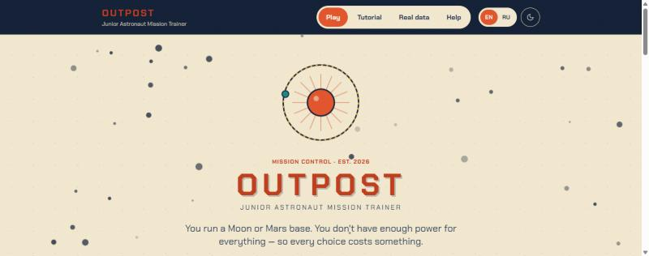
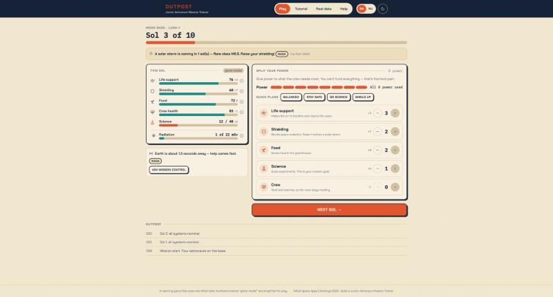

# OUTPOST — Junior Astronaut Mission Trainer

> NASA Space Apps Challenge 2026 · *"Build a Junior Astronaut Mission Trainer"*



**▶ Play it live: https://outpost-junior-astronaut.vercel.app**

🎬 **30-second demo:** [docs/OUTPOST-demo.mp4](./docs/OUTPOST-demo.mp4) · 🖼️ **7-slide deck:** [docs/slides.html](./docs/slides.html) · 📄 **Submission write-up:** [SUBMISSION.md](./SUBMISSION.md)

A browser game for **ages 7–12**. You run a **Moon or Mars base**. Each **sol** (day) you get a limited amount of **power** and must split it across the crew's competing needs — **life support, shielding, food, science, and crew rest**. You can't fund everything, so every choice costs something. Real NASA space-weather data drives the hazards.

> Challenge brief: *"...let kids ages 7–12 manage a lunar or Martian outpost, making real decisions about life support, radiation shielding, power budgeting, food production, and communication delay... every decision teaches something true about what astronauts and mission planners actually navigate."*

---

## Highlights

- 🌗 **Run a Moon or Mars base** over a short mission (10–12 sols) — finishable in a few minutes.
- ⚡ **Split limited power** across 5 competing needs; there is no free "safe" option.
- ☀️ **Real NASA space weather** — live solar flares from NASA DONKI drive your storms.
- 📊 **Mission report** with a sol-by-sol chart of how your base held up.
- 📖 **Built-in tutorial** + plain-language glossary (*sol, dose, shielding, microgravity*).
- 🚀 **Retro-space design** with a splash screen and scroll animations.
- 🌍 **English & Russian**, 🌓 light/dark themes, 📱 installable **PWA** that works offline.



## Run locally

```bash
npm install
npm run dev      # start the dev server
npm test         # run the unit tests (Vitest)
npm run build    # type-check + production build
```

Browser-playable — no download, no account.

### Live NASA data (optional)

The game calls **NASA DONKI** for real solar flares. Without a key it uses the shared `DEMO_KEY`, which is heavily rate-limited and falls back to an embedded archive of real historic flares. For reliable **live** flares, get a free key at **https://api.nasa.gov**, then:

```bash
cp .env.example .env
# edit .env and set VITE_NASA_API_KEY=your_key
```

Either way the flares are **real** and labelled *live* vs *archive* in-game. (The hosted version above already runs on a live key.)

## How it meets the challenge

- **Outpost resource management, 7–12.** Three core meters to watch (life support, shielding, food) plus a crew-health readout and a science goal — not five or six systems at once, as the brief advises.
- **Every choice is a trade-off.** Power spent on shielding is power not spent on science or food.
- **Real NASA data, not invented numbers:**
  - **DONKI (live).** On mission start the game calls NASA's Space Weather Database (`api.nasa.gov/DONKI/notifications?type=FLR`) for real recent **solar flares**, parses their class (M/X), and uses them as your in-game solar storms. Offline or if the call fails, it falls back to a small archive of **real historic flares** (e.g. the 2017 X9.3, the May 2024 X8.7) — never fabricated. Live vs. archive is labelled in-game.
  - **Radiation** doses from NASA's RAD (Mars ~0.64 mSv/day) and Chang'e-4 LND (Moon ~1.3 mSv/day).
  - **Environment** from NASA Mars facts (sol = 24 h 39 min), the lunar night (~14 Earth days), and dust-storm power loss.
  - **Communication delay** — Earth is ~1.3 s from the Moon but minutes from Mars, so on Mars you must decide locally.
  - Every real fact is listed and sourced on the **Real data** page, marked **REAL NASA DATA** vs **game model**.
- **Plain language.** Space terms are explained in-context, in the **Tutorial**, and on the **Help** page.
- **Replayable.** Live flares change by date; hazard placement varies by seed.

## Tech stack

React 18 · TypeScript · Vite · Tailwind CSS · Zustand · Recharts · vite-plugin-pwa · Vitest · deployed on Vercel.

## Project structure

- `src/sim/model.ts` — pure game model (power budget, five needs, hazards, outcome) with unit tests in `model.test.ts` (18 tests).
- `src/sim/donki.ts` — live DONKI fetch + real-flare archive fallback.
- `src/data/` — `sites.json` (Moon/Mars config), `nasa.json` (real facts + flare archive), `sources.json` (datasets, each flagged real/model).
- `src/screens/` — **Brief** (landing), **Tutorial** (how to play), **Console** (the game), **Report** (mission report), **RealData** (Real data), **Help** (glossary).
- `src/i18n/` — English and Russian.

## Honest notes on the model

Shown in-app under **Real data → What the game simplifies**:

- How fast each resource rises/falls per unit of power is a tuned game model.
- Missions are a few sols long so a child can finish in minutes; real missions last months.
- Radiation doses are based on real daily rates but rounded for a simple meter.

A **learning game that uses real NASA data** — not a mission planner.
